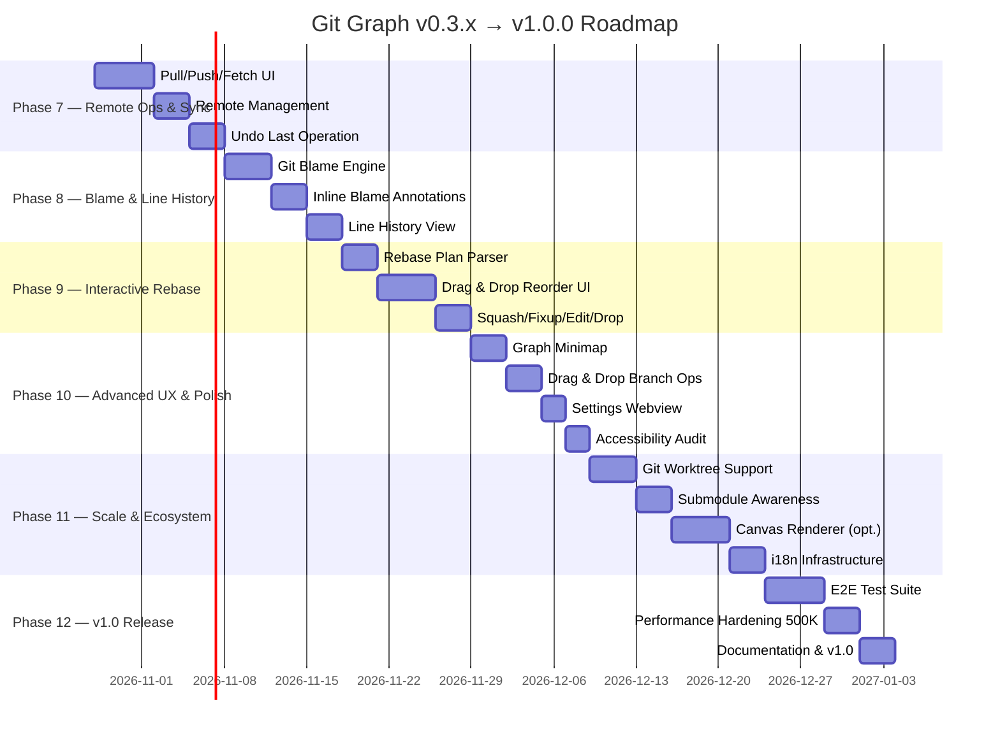

# Kế Hoạch Phát Triển Tiếp Theo — Git Graph Extension v0.3.x → v1.0.0

> **Ngày lập kế hoạch:** 2026-10-22  
> **Phiên bản hiện tại:** `0.2.1`  
> **Chất lượng hiện tại:** 107 test suites / 924 tests pass 100%, 0 lỗi TypeScript, 0 lỗi Lint  
> **Tài liệu tham chiếu:** [`DEVELOPMENT_PLAN.md`](file:///Users/thaoanhhaa1/Documents/IT/Personal/Extension-vscode/git-graph/DEVELOPMENT_PLAN.md), [`AGENTS.md`](file:///Users/thaoanhhaa1/Documents/IT/Personal/Extension-vscode/git-graph/AGENTS.md), [`spec.md`](file:///Users/thaoanhhaa1/Documents/IT/Personal/Extension-vscode/git-graph/spec.md)

---

## 1. Đánh Giá Hiện Trạng — Điểm Mạnh & Khoảng Trống

### 1.1. Những Gì Đã Vững Chắc (v0.2.1)

| Khu vực | Trạng thái |
| :--- | :--- |
| Monorepo architecture (5 workspaces) | ✅ Hoàn chỉnh |
| Graph topology engine + SVG renderer | ✅ Stress-tested 100K commits |
| 15 Git operation dialogs (tag, merge, rebase, reset, cherry-pick, revert, stash) | ✅ Hoàn chỉnh |
| Working tree staging/unstaging/commit/amend | ✅ Hoàn chỉnh |
| Multi-commit range diff | ✅ Hoàn chỉnh |
| Date range / file path / commit ordering filters | ✅ Hoàn chỉnh |
| Status bar, keyboard navigation, column resizing | ✅ Hoàn chỉnh |
| CI/CD (GitHub Actions), VSIX packaging | ✅ Hoàn chỉnh |
| 924 tests, benchmarks, LRU cache bounds | ✅ Hoàn chỉnh |

### 1.2. Khoảng Trống & Cơ Hội Phát Triển (Gaps)

> [!IMPORTANT]
> Dưới đây là phân tích khoảng trống thực sự dựa trên codebase hiện tại, so sánh với các extension hàng đầu (GitLens, Git Graph by mhutchie, GitKraken) và nhu cầu developer chuyên nghiệp.

| # | Gap | Mức Độ | Mô tả |
| :--- | :--- | :--- | :--- |
| G1 | **Pull / Push / Fetch UI** | 🔴 Thiếu hẳn | Backend `GitOperationService` đã có `fetch`, nhưng chưa có Pull/Push dialog. Developer phải quay về terminal cho workflow hàng ngày. |
| G2 | **Interactive Rebase** | 🔴 Thiếu hẳn | Chỉ có rebase đơn giản. Chưa hỗ trợ reorder/squash/fixup/edit/drop commits. |
| G3 | **Blame / Line History** | 🔴 Thiếu hẳn | Chưa có inline blame annotations hoặc line-level history tracking. |
| G4 | **Remote Management** | 🟡 Sơ khai | Không có UI quản lý remotes (add/remove/rename remote). |
| G5 | **Submodule Support** | 🟡 Thiếu | Không nhận diện hay hiển thị submodules trong graph. |
| G6 | **Settings UI** | 🟡 Thiếu | Config chỉ qua `settings.json`, chưa có Settings Webview tích hợp. |
| G7 | **Drag & Drop Interactions** | 🟡 Thiếu | Không hỗ trợ kéo branch badge để merge/rebase trực quan. |
| G8 | **Undo Last Operation** | 🟡 Thiếu | Không có nút "Undo" cho các operation vừa thực hiện (via `git reflog`). |
| G9 | **Minimap / Overview** | 🟡 Thiếu | Repo lớn thiếu minimap để định vị nhanh trong graph. |
| G10 | **Worktree Management** | 🟡 Thiếu | Chưa hỗ trợ `git worktree` (multiple working trees). |
| G11 | **Canvas Renderer** | 🟡 Chưa cần thiết | SVG đã pass benchmark 100K, nhưng >500K commits có thể cần Canvas. |
| G12 | **Localization (i18n)** | 🟡 Thiếu | Chỉ có tiếng Anh, chưa có hạ tầng đa ngôn ngữ. |
| G13 | **Extension Settings Sync** | 🟡 Thiếu | Column widths, view preferences chưa sync qua VS Code Settings Sync. |
| G14 | **Accessibility Audit** | 🟡 Cần cải thiện | Có ARIA cơ bản, nhưng chưa có kiểm tra WCAG 2.1 AA toàn diện. |
| G15 | **E2E Test Suite** | 🟡 Sơ khai | Có framework E2E nhưng chưa có test cases thực tế chạy trong VS Code host. |

---

## 2. Lộ Trình Phát Triển Tổng Quan (Roadmap)



---

## 3. Kế Hoạch Chi Tiết Từng Phase

---

### Phase 7 — Remote Operations & Sync (v0.3.0)

> **Mục tiêu:** Biến Git Graph thành trung tâm điều khiển Git hàng ngày hoàn chỉnh — developer không cần quay về terminal cho push/pull/fetch.

#### M15.1 — Pull, Push & Fetch Dialogs

**Nội dung:**

- `FetchDialog.tsx`:
  - Dropdown chọn remote (nếu có nhiều remotes).
  - Checkbox `--prune` (xóa remote-tracking branches đã bị xóa trên server).
  - Checkbox `Fetch All Remotes`.
  - Progress bar hiển thị trạng thái fetch.

- `PullDialog.tsx`:
  - Hiển thị rõ ràng: Pull từ `<remote>/<branch>` vào `<current branch>`.
  - Radio chọn strategy: `Merge (default)`, `Rebase (--rebase)`, `Fast-Forward Only (--ff-only)`.
  - Checkbox `--autostash` (tự động stash changes trước khi pull).

- `PushDialog.tsx`:
  - Hiển thị: Push `<current branch>` lên `<remote>`.
  - Checkbox `--force-with-lease` (an toàn hơn force push, kèm cảnh báo đỏ).
  - Checkbox `Set upstream (-u)` (thiết lập tracking branch).
  - Checkbox `Push Tags` (`--tags`).
  - Hiển thị ahead/behind counter trước khi push.

**Protocol bổ sung:**
```
operation.fetch.request    { repositoryId, remote?, prune?, all? }
operation.pull.request     { repositoryId, remote?, branch?, rebase?, ffOnly?, autostash? }
operation.push.request     { repositoryId, remote?, branch?, force?, forceWithLease?, setUpstream?, tags? }
```

**Tích hợp UI:**
- Thêm 3 nút trên Toolbar: `↓ Pull`, `↑ Push`, `⟳ Fetch` (icon buttons).
- Context menu trên remote branch badge: "Push", "Pull from".
- Status bar ahead/behind click → mở Push/Pull dialog tương ứng.

**Verify:**
- Test submit payload cho từng dialog.
- Test hiển thị cảnh báo force push.
- Test progress bar và xử lý lỗi authentication.

---

#### M15.2 — Remote Management

**Nội dung:**

- `RemoteManagerDialog.tsx`:
  - Liệt kê tất cả remotes hiện tại (name, URL, fetch/push).
  - Nút "Add Remote": Nhập name + URL, validate.
  - Nút "Remove Remote": Xác nhận xóa (kèm cảnh báo mất remote-tracking branches).
  - Nút "Rename Remote": Đổi tên.
  - Nút "Edit URL": Sửa fetch/push URL.

**Protocol bổ sung:**
```
remote.list.request
remote.add.request       { repositoryId, name, url }
remote.remove.request    { repositoryId, name }
remote.rename.request    { repositoryId, oldName, newName }
```

**Verify:**
- Test CRUD operations trên remote.
- Test validation tên remote trùng lặp.

---

#### M15.3 — Undo Last Operation (Git Reflog Integration)

**Nội dung:**

- Sau mỗi mutating operation thành công, lưu reflog entry vào `operationHistory` (in-memory, tối đa 20 entries).
- Toast thông báo thành công kèm nút **"Undo"**.
- Click Undo → xác nhận → thực hiện `git reset --hard HEAD@{1}` (hoặc reflog tương ứng).
- Chỉ hỗ trợ undo cho: reset, merge, rebase, cherry-pick, revert, commit, amend.
- Undo không khả thi cho: push, fetch, delete remote branch → hiển thị tooltip giải thích.

**Protocol bổ sung:**
```
operation.undo.request   { repositoryId, reflogIndex }
reflog.recent.request    { repositoryId, limit: 20 }
```

**Verify:**
- Test undo sau reset hard.
- Test undo không khả thi (push) → Toast info thay vì nút Undo.

---

### Phase 8 — Git Blame & Line History (v0.3.1)

> **Mục tiêu:** Cung cấp khả năng truy vết "ai đã sửa dòng này, khi nào, vì sao" — tính năng được yêu cầu nhiều nhất từ developer chuyên nghiệp.

#### M16.1 — Git Blame Engine

**Nội dung:**

- `packages/git-core/src/queries/BlameQuery.ts`:
  - Chạy `git blame --porcelain <file>` để lấy blame data chi tiết.
  - Parser chuyển output thành `BlameLineInfo[]`: sha, author, date, line content, original line number.
  - Hỗ trợ blame tại revision cụ thể: `git blame <sha> -- <file>`.
  - Cache blame result theo `repositoryId + filePath + sha`.

- `packages/shared/src/domain/BlameInfo.ts`:
```typescript
interface BlameLineInfo {
  sha: string;
  shortSha: string;
  author: string;
  authorEmail: string;
  timestamp: number;
  subject: string;
  lineNumber: number;
  originalLineNumber: number;
  content: string;
}

interface BlameResult {
  filePath: string;
  revision: string;
  lines: BlameLineInfo[];
}
```

**Verify:**
- Unit test parser với file có: rename history, binary boundary, UTF-8 content.
- Performance test: blame file 10K dòng < 500ms.

---

#### M16.2 — Inline Blame Annotations (VS Code Editor Decoration)

**Nội dung:**

- `apps/extension/src/blame/BlameDecorationProvider.ts`:
  - Đăng ký `TextEditorDecoration` hiển thị blame info ở cuối mỗi dòng (mờ, kiểu GitLens).
  - Format: `Author Name, X hours ago • commit subject`.
  - Hover tooltip chi tiết: full SHA, author email, full timestamp, commit body.
  - Click vào blame decoration → highlight commit tương ứng trong Git Graph.

- Command: `gitGraph.toggleBlame` — bật/tắt blame annotations cho editor hiện tại.
- Configuration: `gitGraph.blame.enabled` (boolean, default `false`), `gitGraph.blame.format` (customizable format string).

**Tích hợp:**
- Khi Git Graph đang mở và user click blame → scroll đến commit trong graph, highlight nó.
- Blame tự động cập nhật khi file thay đổi (debounced 1s).

**Verify:**
- Test decoration render đúng vị trí.
- Test blame cập nhật sau khi commit mới.
- Test toggle on/off không leak decorations.

---

#### M16.3 — Line History View

**Nội dung:**

- Command: `gitGraph.viewLineHistory` — truy vết lịch sử của dòng/đoạn code đang được chọn.
- `git log -L <start>,<end>:<file>` để lấy toàn bộ lịch sử thay đổi của range dòng.
- Hiển thị kết quả trong Git Graph panel với filter tự động, hoặc trong panel phụ.
- Mỗi entry hiển thị: commit info + diff snippet cho dòng đó.

**Verify:**
- Test line history cho file có rename.
- Test range selection spanning multiple hunks.

---

### Phase 9 — Interactive Rebase (v0.4.0)

> **Mục tiêu:** Cho phép developer chỉnh sửa lịch sử commit một cách trực quan — reorder, squash, fixup, edit, drop — tất cả qua drag & drop UI.

> [!WARNING]
> Interactive rebase là tính năng phức tạp nhất, có khả năng gây mất dữ liệu. Cần implement cực kỳ cẩn thận với nhiều tầng bảo vệ.

#### M17.1 — Rebase Plan Parser & Editor

**Nội dung:**

- `packages/git-core/src/queries/RebasePlanQuery.ts`:
  - Lấy danh sách commits trong range `HEAD...<target>` cho interactive rebase.
  - Parse rebase-todo format: `pick <sha> <subject>`.

- `RebasePlanEntry` model:
```typescript
interface RebasePlanEntry {
  action: 'pick' | 'reword' | 'edit' | 'squash' | 'fixup' | 'drop';
  sha: string;
  shortSha: string;
  subject: string;
  author: string;
  date: number;
}
```

- Tích hợp với `GIT_SEQUENCE_EDITOR` environment variable để inject rebase plan tự động.

---

#### M17.2 — Interactive Rebase UI (Drag & Drop Reorder)

**Nội dung:**

- `InteractiveRebaseDialog.tsx`:
  - Hiển thị danh sách commits sẽ bị rebase (mới nhất ở trên).
  - Mỗi entry có:
    - Dropdown chọn action: `pick`, `reword`, `squash`, `fixup`, `edit`, `drop`.
    - Drag handle để reorder bằng kéo thả.
    - Preview: dòng bị `drop` → gạch ngang mờ, `squash`/`fixup` → indent vào commit phía trên.
  - Nút "Start Rebase" → gửi plan xuống extension.
  - Progress: hiển thị current step / total steps.
  - Nếu conflict → hiển thị conflict banner với Continue/Abort/Skip.

- `InteractiveRebaseStore.ts` (Zustand):
  - State: `entries: RebasePlanEntry[]`, `currentStep`, `status`, `conflicts`.
  - Actions: `reorder`, `setAction`, `startRebase`, `continueRebase`, `abortRebase`.

**Protocol bổ sung:**
```
rebase.interactive.plan.request    { repositoryId, onto }
rebase.interactive.start.request   { repositoryId, plan: RebasePlanEntry[] }
rebase.interactive.continue        { repositoryId }
rebase.interactive.abort           { repositoryId }
```

**Verify:**
- Test drag & drop reorder cập nhật state đúng.
- Test squash 3 commits thành 1.
- Test abort giữa chừng → repo trở lại trạng thái ban đầu.
- Test conflict flow: pause → resolve → continue.

---

#### M17.3 — Squash, Fixup, Edit & Drop Actions

**Nội dung:**

- **Reword:** Khi chọn `reword`, mở TextInput để sửa commit message ngay trong dialog.
- **Squash:** Tự động merge commit message của commit bị squash vào commit trước.
- **Fixup:** Giống squash nhưng bỏ commit message.
- **Edit:** Pause rebase tại commit đó, cho phép user chỉnh sửa code → `git rebase --continue`.
- **Drop:** Bỏ commit (với confirmation nếu commit đã published).

**Tích hợp context menu:**
- Right-click commit trong graph → "Interactive Rebase from Here" (rebase commits từ commit được chọn về HEAD).
- Right-click commit → "Fixup into Previous" (shortcut cho fixup đơn lẻ).

---

### Phase 10 — Advanced UX & Polish (v0.4.1)

> **Mục tiêu:** Nâng trải nghiệm người dùng lên tầm premium với các tính năng trực quan, mượt mà.

#### M18.1 — Graph Minimap / Overview

**Nội dung:**

- Thanh minimap dọc ở bên phải graph (tương tự minimap của VS Code editor).
- Hiển thị tổng quan topology: các nhánh chính, điểm merge, tag lớn.
- Highlight vùng viewport hiện tại.
- Click vào minimap → scroll đến vị trí tương ứng.
- Có thể tắt qua `gitGraph.showMinimap` (default: `true`).

**Kỹ thuật:**
- Render minimap bằng offscreen Canvas (không dùng SVG vì minimap cần render toàn bộ graph).
- Throttle re-render minimap khi scroll (requestAnimationFrame).
- Chỉ render lane lines + commit dots (không render text).

**Verify:**
- Test minimap sync đúng scroll position.
- Performance: minimap render < 16ms cho 10K commits.

---

#### M18.2 — Drag & Drop Branch Operations

**Nội dung:**

- Kéo badge branch lên commit khác → mở dialog tương ứng:
  - Kéo branch A lên commit thuộc branch B → `MergeDialog` hoặc `RebaseDialog` (user chọn).
  - Kéo branch lên commit cụ thể → `ResetDialog` (reset branch đến commit).
- Visual feedback khi kéo: hiển thị ghost badge + highlight drop target.
- Hỗ trợ cả mouse và touch.

**Verify:**
- Test drag từ branch badge → commit row → đúng dialog mở.
- Test cancel drag (thả ra ngoài) → không có side effect.

---

#### M18.3 — Settings Webview

**Nội dung:**

- Panel settings tích hợp trong Git Graph (tab hoặc gear icon):
  - Tổ chức theo categories: Display, Git, Graph, Performance.
  - Mỗi setting có description, current value, reset to default.
  - Thay đổi apply ngay lập tức (không cần reload).
- Đồng bộ 2 chiều với `settings.json` của VS Code.
- Hiển thị tất cả `gitGraph.*` settings + column widths + view preferences.

---

#### M18.4 — Accessibility Audit & Improvements

**Nội dung:**

- Kiểm tra WCAG 2.1 AA compliance toàn bộ webview:
  - Color contrast ratio ≥ 4.5:1 cho text, ≥ 3:1 cho large text.
  - Focus visible trên mọi interactive element.
  - Screen reader: aria-label cho mọi SVG graph element, role cho tables/lists.
  - Reduced motion: tắt animation khi `prefers-reduced-motion: reduce`.
- Bổ sung `aria-live` regions cho toast, operation progress, conflict banner.
- Tab order logic cho dialog chain (dialog → toast → back to trigger).

**Verify:**
- Chạy Accessibility Insights / axe DevTools, 0 critical violations.
- Test screen reader (VoiceOver) đọc được graph summary.

---

### Phase 11 — Scale & Ecosystem (v0.5.0)

> **Mục tiêu:** Mở rộng Git Graph cho các use cases nâng cao: worktree, submodule, quy mô cực lớn.

#### M19.1 — Git Worktree Support

**Nội dung:**

- Nhận diện và liệt kê linked worktrees: `git worktree list`.
- Hiển thị worktree badge trên branch tương ứng (branch đang checked out ở worktree khác).
- `WorktreeManagerDialog.tsx`:
  - Liệt kê worktrees (path, branch, HEAD commit).
  - "Add Worktree": chọn branch + đường dẫn.
  - "Remove Worktree": xóa (kèm `--force` option).
  - "Open in New Window": mở worktree path trong VS Code window mới.

**Protocol bổ sung:**
```
worktree.list.request
worktree.add.request      { repositoryId, path, branch?, newBranch? }
worktree.remove.request   { repositoryId, path, force? }
```

---

#### M19.2 — Submodule Awareness

**Nội dung:**

- Phát hiện submodules qua `.gitmodules`.
- Hiển thị submodule entries trong commit changed files với badge `[submodule]`.
- Click vào submodule → option "Open Submodule in Git Graph" (mở graph riêng cho submodule repo).
- Status indicator: submodule dirty, submodule ahead/behind.

---

#### M19.3 — Canvas Renderer (Optional — Performance Driven)

**Nội dung:**

- Benchmark SVG renderer tại 500K commits. Nếu frame time > 16ms → implement Canvas fallback.
- `CanvasGraphRenderer.ts`:
  - Sử dụng OffscreenCanvas cho worker thread rendering.
  - Vẽ lane lines bằng `CanvasRenderingContext2D`.
  - Hit testing cho click/hover trên Canvas elements.
- Config: `gitGraph.renderer` → `"svg" | "canvas" | "auto"`.
- `"auto"`: tự chọn dựa trên commit count threshold (default: >100K → canvas).

> [!NOTE]
> Chỉ implement Canvas renderer khi benchmark SVG chứng minh cần thiết. Hiện tại SVG đã pass 100K commits trong 23.87MB memory.

---

#### M19.4 — Localization Infrastructure (i18n)

**Nội dung:**

- Setup i18n framework:
  - Extension host: sử dụng VS Code built-in `vscode.l10n` API.
  - Webview: lightweight i18n wrapper (không dùng thư viện nặng).
- Tạo `l10n/` directory với:
  - `bundle.l10n.json` (English — source).
  - `bundle.l10n.vi.json` (Vietnamese).
  - `bundle.l10n.ja.json` (Japanese).
  - `bundle.l10n.zh-cn.json` (Chinese Simplified).
- Wrap tất cả user-facing strings bằng `l10n.t()`.
- Ngôn ngữ tự động theo VS Code display language.

---

### Phase 12 — v1.0.0 Release (Production-Grade)

> **Mục tiêu:** Đạt chất lượng Production-Grade tuyệt đối, sẵn sàng cho hàng triệu developer sử dụng hàng ngày.

#### M20.1 — E2E Test Suite Hoàn Chỉnh

**Nội dung:**

- Sử dụng `@vscode/test-electron` để chạy E2E trong VS Code host thực.
- Test scenarios:

| # | Scenario | Mô tả |
| :--- | :--- | :--- |
| E1 | Open & Render | Mở Git Graph, assert graph render đúng branch/commits |
| E2 | Search & Filter | Search commit, apply branch filter, verify kết quả |
| E3 | Commit Workflow | Stage files → commit → graph refresh hiển thị commit mới |
| E4 | Branch Operations | Create branch → checkout → delete branch |
| E5 | Merge Workflow | Merge dialog → execute → graph update |
| E6 | Stash Workflow | Stash save → stash pop → verify working tree |
| E7 | Push/Pull | Push to remote → verify status bar update |
| E8 | Blame Toggle | Toggle blame → verify decorations |
| E9 | Multi-Repo | Switch repo → verify graph changes |
| E10 | Large Repo | Scroll 50K commits → verify memory < 120MB |

---

#### M20.2 — Performance Hardening 500K Commits

**Nội dung:**

- Mở rộng benchmark suite: 500K synthetic commits.
- Target metrics:

| Metric | Target |
| :--- | :--- |
| Initial render (500 commits) | < 200ms |
| Page load (next 500) | < 100ms |
| Graph layout (500 commits) | < 50ms |
| Search (loaded commits) | < 50ms |
| Memory (100K commits paged) | < 150MB |
| Scroll frame time | < 16ms (60 FPS) |

- Nếu SVG không đạt target → chuyển sang Canvas renderer (M19.3).
- Profile memory leaks qua Chrome DevTools Heap Snapshot.
- Xuất benchmark report so sánh v0.2.1 vs v1.0.0.

---

#### M20.3 — Documentation, Branding & v1.0.0 Release

**Nội dung:**

- **README.md** nâng cấp:
  - GIF/video demo cho từng tính năng chính.
  - Feature comparison table vs GitLens, Git Graph (mhutchie).
  - Badges: Marketplace installs, rating, version.

- **Website / Landing Page** (optional):
  - Trang giới thiệu tại GitHub Pages.
  - Screenshots, feature highlights, quick start guide.

- **CHANGELOG.md** cập nhật đầy đủ v0.3.0 → v1.0.0.

- **Marketplace Listing**:
  - Cập nhật description, tags, categories.
  - Screenshots tối thiểu 5 hình chất lượng cao.
  - Publisher verified badge.

- **CI/CD Enhancement**:
  - Auto-publish to Marketplace on tag push.
  - Nightly build + smoke test.
  - Dependabot cho security updates.

---

## 4. Bảng Kế Hoạch Triển Khai (Backlog)

| ID | Task | Phase | Độ Ưu Tiên | Ước Lượng | Phụ Thuộc | Trạng Thái |
| :--- | :--- | :--- | :--- | :--- | :--- | :--- |
| **GG3-01** | `FetchDialog`, `PullDialog`, `PushDialog` | 7 | P0 | 3 ngày | UI Primitives | ⬜ |
| **GG3-02** | Remote Management UI | 7 | P1 | 2 ngày | GG3-01 | ⬜ |
| **GG3-03** | Undo Last Operation (Reflog) | 7 | P1 | 2 ngày | GG3-01 | ⬜ |
| **GG3-04** | Git Blame Engine & Parser | 8 | P0 | 2 ngày | git-core | ⬜ |
| **GG3-05** | Inline Blame Decorations | 8 | P0 | 2 ngày | GG3-04 | ⬜ |
| **GG3-06** | Line History View | 8 | P1 | 2 ngày | GG3-04 | ⬜ |
| **GG3-07** | Interactive Rebase Plan Parser | 9 | P0 | 2 ngày | git-core | ⬜ |
| **GG3-08** | Interactive Rebase Drag & Drop UI | 9 | P0 | 4 ngày | GG3-07 | ⬜ |
| **GG3-09** | Squash/Fixup/Edit/Drop Actions | 9 | P0 | 2 ngày | GG3-08 | ⬜ |
| **GG3-10** | Graph Minimap | 10 | P2 | 3 ngày | Graph Engine | ⬜ |
| **GG3-11** | Drag & Drop Branch Operations | 10 | P2 | 3 ngày | UI Primitives | ⬜ |
| **GG3-12** | Settings Webview | 10 | P2 | 2 ngày | — | ⬜ |
| **GG3-13** | Accessibility Audit | 10 | P1 | 2 ngày | — | ⬜ |
| **GG3-14** | Git Worktree Support | 11 | P1 | 3 ngày | git-core | ⬜ |
| **GG3-15** | Submodule Awareness | 11 | P2 | 2 ngày | git-core | ⬜ |
| **GG3-16** | Canvas Renderer (conditional) | 11 | P3 | 4 ngày | Benchmark | ⬜ |
| **GG3-17** | i18n Infrastructure | 11 | P2 | 3 ngày | — | ⬜ |
| **GG3-18** | E2E Test Suite (10 scenarios) | 12 | P0 | 4 ngày | All features | ⬜ |
| **GG3-19** | Performance Hardening 500K | 12 | P0 | 3 ngày | GG3-16? | ⬜ |
| **GG3-20** | Documentation & v1.0.0 Release | 12 | P0 | 3 ngày | All | ⬜ |

**Tổng ước lượng:** ~52 ngày (10-12 tuần với buffer)

---

## 5. Thứ Tự Triển Khai Đề Xuất (Sprint Plan)

```
Sprint 1 (Tuần 1-2): GG3-01, GG3-02, GG3-03
  → Release v0.3.0: Remote Operations & Sync

Sprint 2 (Tuần 3-4): GG3-04, GG3-05, GG3-06
  → Release v0.3.1: Git Blame & Line History

Sprint 3 (Tuần 5-6): GG3-07, GG3-08, GG3-09
  → Release v0.4.0: Interactive Rebase

Sprint 4 (Tuần 7-8): GG3-10, GG3-11, GG3-12, GG3-13
  → Release v0.4.1: Advanced UX & Polish

Sprint 5 (Tuần 9-10): GG3-14, GG3-15, GG3-16, GG3-17
  → Release v0.5.0: Scale & Ecosystem

Sprint 6 (Tuần 11-12): GG3-18, GG3-19, GG3-20
  → Release v1.0.0: Production-Grade
```

---

## 6. Quy Chuẩn Kỹ Thuật (Tiếp Tục Áp Dụng)

> [!IMPORTANT]
> Tất cả quy tắc từ [`AGENTS.md`](file:///Users/thaoanhhaa1/Documents/IT/Personal/Extension-vscode/git-graph/AGENTS.md) **tiếp tục có hiệu lực** cho toàn bộ các phase mới. Đặc biệt lưu ý:

1. **Ranh giới phụ thuộc:** Webview không import `vscode`. Protocol messages qua `packages/shared`.
2. **Zustand granular selectors:** Cấm destructuring toàn bộ store.
3. **React.memo + useCallback:** Bắt buộc cho mọi list/row component mới.
4. **UI Primitives tái sử dụng:** Tất cả dialog mới phải dùng `Modal`, `ModalTitle`, `ModalField`, `ModalActions`. Icon đăng ký qua `icons.tsx`.
5. **Definition of Done:** Mỗi task pass `typecheck` + `lint` + `format` + `test`.
6. **Benchmark:** Khi sửa hot path → chạy `npm run benchmark:quick`.
7. **No breaking changes:** Giữ `data-testid`, CSS class names, ARIA roles hiện có.

---

## 7. Rủi Ro & Chiến Lược Giảm Thiểu

| Rủi ro | Xác suất | Ảnh hưởng | Chiến lược |
| :--- | :--- | :--- | :--- |
| Interactive rebase gây mất dữ liệu | Trung bình | 🔴 Cao | Multi-layer confirmation, auto-backup stash trước rebase, E2E test |
| Push force ghi đè code đồng nghiệp | Thấp | 🔴 Cao | Mặc định `--force-with-lease`, cảnh báo đỏ, checkbox xác nhận |
| Canvas renderer phức tạp hóa maintenance | Trung bình | 🟡 Trung bình | Chỉ implement khi benchmark chứng minh cần, interface chung SVG/Canvas |
| i18n tăng bundle size | Thấp | 🟡 Thấp | Lazy-load language bundles, chỉ ship ngôn ngữ phổ biến |
| E2E tests flaky | Cao | 🟡 Trung bình | Retry logic, deterministic test repos, headless mode |

---

> **Bước tiếp theo:** Chọn Phase/Sprint để bắt đầu triển khai. Khuyến nghị bắt đầu từ **Sprint 1 (Phase 7 — Remote Operations)** vì đây là gap lớn nhất ảnh hưởng đến workflow hàng ngày của developer.
