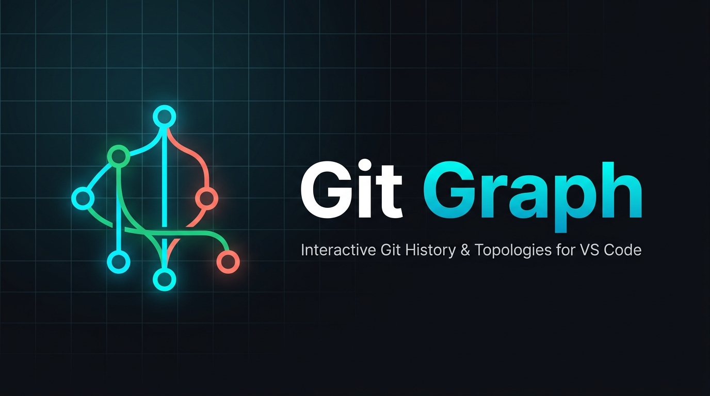

<p align="center">
  
</p>

# Git Graph for VS Code

[](https://github.com/git-graph/vscode-git-graph/actions/workflows/ci.yml)
[](https://github.com/git-graph/vscode-git-graph/actions/workflows/release.yml)
[](https://opensource.org/licenses/MIT)

**Git Graph** is a high-performance, developer-friendly VS Code extension for exploring Git histories in an interactive graph. It automatically discovers repositories across your workspace, renders branches, tags, merge topologies, and working tree changes, and exposes safe local Git operations directly from a responsive webview UI.

---

## Key Features

### 1. Virtualized Graph Topology View
- **Virtualized Rendering:** Smooth 60 FPS scrolling through repositories of any size (stress-tested on 50,000–100,000 commits) by rendering only visible rows plus overscan.
- **Topological Branch Lanes:** Curved and straight SVG vector lanes with distinct color palettes, branching lines, merge connections, and pass-through tracks.
- **Multi-Repository Switcher:** Instant discovery and seamless switching between monorepos or multiple workspace roots.
- **Interactive Search:** Filter commits in real time by Subject, Author, Commit Hash, or Changed File.

```
* (HEAD -> main, origin/main) feat: finalize phase 6 marketplace release
| * (feature/safe-rebase) test: add rebase published branch guard tests
|/
* chore: prepare vsix packaging and performance benchmarks
* (tag: v0.2.0) feat: uncommitted changes staging and direct commit form
```

### 2. Working Tree Staging & Committing
- **Uncommitted Changes Row:** Pinned directly above repository HEAD (`*`) with live status counter.
- **Staged vs Unstaged Views:** Clear split view showing modified (`M`), added (`A`), deleted (`D`), renamed (`R`), and untracked (`?`) files.
- **One-Click Actions:** Stage (`+`), Unstage (`-`), or Discard (with confirmation modal) for individual files or the entire worktree.
- **Direct Commit Form:** Write commit summary and multiline description without switching to terminal.
- **Amend Mode:** Checkbox automatically prefills the previous HEAD commit message for seamless amends.
- **Stash Management:** Save changes (with untracked options), list, apply, pop, or drop stashes from `StashManagerDialog`.

### 3. Merge, Rebase, Reset & Sequencer Workflows
- **Merge Dialog:** Safe merge dialog with Fast-Forward options (`Default`, `--no-ff`, `--ff-only`, `--squash`).
- **Rebase Dialog:** Built-in published branch protection guard warning against rebasing commits already pushed to remote remotes.
- **Reset Dialog:** Soft (`--soft`), Mixed (`--mixed`), and Hard (`--hard`) reset modes with prominent danger confirmation on destructive operations.
- **Cherry-Pick & Revert:** Dedicated dialogs featuring mainline parent selection (`-m 1`, `-m 2`) for merge commits and `--no-commit` option.
- **Tag Lifecycle:** Create annotated or lightweight tags (`CreateTagDialog`) and delete local or remote tags (`DeleteTagDialog`).

### 4. File History & Diff Comparison
- **Multi-Commit Range Diff:** Select two commits using `Ctrl` / `Cmd` + Click to open side-by-side comparison matrix and changed files summary.
- **File History Filter:** Right-click any file in VS Code Explorer or editor tab and choose **View History in Git Graph** (`gitGraph.viewFileHistory`) to filter commits touching that file.
- **Date Range Filters:** Quickly isolate commits using presets (Last 24 Hours, 7 Days, 30 Days) or custom dates (`CustomDateRangeDialog`).
- **Commit Ordering:** Choose between `--date-order`, `--topo-order`, and `--author-date-order`.

---

## Keyboard Shortcuts

| Shortcut | Action |
| :--- | :--- |
| `ArrowDown` / `ArrowUp` | Move commit selection down / up |
| `Enter` | Toggle commit details / diff panel open or closed |
| `Space` | Open details / diff for the currently focused commit |
| `Escape` | Close details panel or dismiss active dialog |
| `Home` / `End` | Jump to the newest (top) / oldest (bottom) commit |
| `Ctrl + F` / `Cmd + F` | Focus search filter input |

---

## Configuration Reference

You can configure Git Graph in VS Code Settings (`settings.json`):

| Setting | Type | Default | Description |
| :--- | :--- | :--- | :--- |
| `gitGraph.pageSize` | `number` | `500` | Number of commits requested per graph page. |
| `gitGraph.showAuthor` | `boolean` | `true` | Show or hide the Author column in the table. |
| `gitGraph.showDate` | `boolean` | `true` | Show or hide the Date column in the table. |
| `gitGraph.showRemoteBranches` | `boolean` | `true` | Display remote branch references in the graph. |
| `gitGraph.showTags` | `boolean` | `true` | Display tag references in the graph. |
| `gitGraph.dateType` | `string` | `"relative"` | Commit timestamp format: `"relative"` or `"absolute"`. |
| `gitGraph.commitOrdering` | `string` | `"date-order"` | Strategy: `"date-order"`, `"topo-order"`, or `"author-date-order"`. |

---

## Commands

- `Git Graph: View Git Graph` (`gitGraph.openGraph`): Opens the interactive commit graph panel. Also accessible from the Source Control title bar and Status Bar.
- `Git Graph: View History in Git Graph` (`gitGraph.viewFileHistory`): Opens Git Graph scoped to the currently active or selected file path.
- `Git Graph: Open File at Revision` (`gitGraph.openFileAtRevision`): Opens a historical version of a file from a specific commit.

---

## Requirements

- **VS Code:** Version `1.85.0` or newer.
- **Git:** Git CLI available on your system `PATH`.
- **Platform:** macOS, Linux, and Windows supported.

---

## Architecture & Performance Guarantees

Git Graph is built as a modular TypeScript monorepo designed for scale:

- **Strict Memory Budget:** Webview memory stays under **120MB** even when paging through repositories containing 50,000–100,000 commits.
- **Bounded LRU Caches:** Commit details cache strictly bounded to **500 entries** (`DETAILS_CACHE_LIMIT`), diff cache strictly bounded to **100 entries** (`DIFF_CACHE_LIMIT`).
- **Zero Inline Allocations:** Granular Zustand selectors and memoized callbacks prevent cascaded re-renders.
- **O(1) Hash Lookups:** Commits and refs indexed in pre-calculated Maps rather than scanning arrays during rendering.
- **Compact View:** Easily toggle between Standard (28px) and Compact (18px) row height to fit more history on smaller displays.

---

## Privacy & Security

Git Graph executes the local `git` binary only to read repository metadata and execute requested operations. **No repository code, commits, author names, branch names, or diffs are ever transmitted to external servers or telemetry endpoints.** Everything remains strictly local to your machine.

---

## Development & Building

```sh
# Install dependencies
npm ci

# Build all packages & webview
npm run build

# Run type checking across workspaces
npm run typecheck

# Run linter
npm run lint

# Run all test suites (unit + integration)
npm test

# Run stress & memory profiling benchmark
npm run benchmark

# Package production VSIX
npm run package
```

Packaging builds all workspaces, removes source maps, copies webview assets, and creates `dist/vscode-git-graph-0.2.0.vsix`.

---

## License

[MIT](LICENSE) © Git Graph Contributors.
