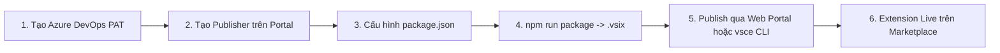

# Hướng Dẫn Từng Bước Publish Extension Lên VS Code Marketplace

Tài liệu này hướng dẫn chi tiết từng bước (step-by-step) để đưa extension **Git Graph** lên kho ứng dụng chính thức của Visual Studio Code (**Visual Studio Marketplace**), cũng như cách quản lý phiên bản và tự động hóa qua CI/CD.

---

## Mục Lục

1. [Tổng Quan Quy Trình](#1-tổng-quan-quy-trình)
2. [Bước 1: Tạo Tài Khoản & Personal Access Token (PAT) trên Azure DevOps](#bước-1-tạo-tài-khoản--personal-access-token-pat-trên-azure-devops)
3. [Bước 2: Tạo Publisher trên VS Code Marketplace Portal](#bước-2-tạo-publisher-trên-vs-code-marketplace-portal)
4. [Bước 3: Cấu Hình Thông Tin Extension Trong Codebase](#bước-3-cấu-hình-thông-tin-extension-trong-codebase)
5. [Bước 4: Kiểm Tra Chất Lượng & Đóng Gói (Package VSIX)](#bước-4-kiểm-tra-chất-lượng--đóng-gói-package-vsix)
6. [Bước 5: Tiến Hành Publish Extension Lên Marketplace](#bước-5-tiến-hành-publish-extension-lên-marketplace)
   - [Cách A: Upload trực tiếp qua Web Portal (Khuyên dùng cho lần đầu)](#cách-a-upload-trực-tiếp-qua-web-portal-khuyên-dùng-cho-lần-đầu)
   - [Cách B: Publish bằng dòng lệnh CLI (`@vscode/vsce`)](#cách-b-publish-bằng-dòng-lệnh-cli-vscodevsce)
   - [Cách C: Tự động hóa qua GitHub Actions (CI/CD)](#cách-c-tự-động-hóa-qua-github-actions-cicd)
7. [Bước 6: Kiểm Tra Sau Khi Publish & Cập Nhật Phiên Bản Mới](#bước-6-kiểm-tra-sau-khi-publish--cập-nhật-phiên-bản-mới)
8. [Tùy Chọn: Publish lên Open VSX Registry (Cho VSCodium & Gitpod)](#tùy-chọn-publish-lên-open-vsx-registry-cho-vscodium--gitpod)
9. [Xử Lý Các Lỗi Thường Gặp (Troubleshooting)](#xử-lý-các-lỗi-thường-gặp-troubleshooting)

---

## 1. Tổng Quan Quy Trình

Để publish một extension lên VS Code Marketplace, bạn cần trải qua 3 giai đoạn:



---

## Bước 1: Tạo Tài Khoản & Personal Access Token (PAT) trên Azure DevOps

Microsoft sử dụng Azure DevOps để quản lý quyền truy cập và xác thực tài khoản phát hành extension.

1. **Đăng nhập vào Azure DevOps**:
   - Truy cập: [https://dev.azure.com](https://dev.azure.com)
   - Đăng nhập bằng tài khoản Microsoft cá nhân hoặc tài khoản GitHub của bạn.
   - Nếu chưa có Organization nào, hãy tạo một Organization mới (ví dụ: `https://dev.azure.com/<tên-của-bạn>`).

2. **Tạo Personal Access Token (PAT)**:
   - Tại trang chủ Azure DevOps, bấm vào biểu tượng **User settings** (hình bánh răng có icon người ở góc trên cùng bên phải màn hình).
   - Chọn **Personal access tokens**.
   - Bấm nút **+ New Token**.

3. **Điền thông tin cấu hình Token (CỰC KỲ QUAN TRỌNG)**:
   - **Name**: Nhập tên gợi nhớ (ví dụ: `vscode-marketplace-token`).
   - **Organization**: Chọn **All accessible organizations** *(Lưu ý: Nếu chỉ chọn 1 tổ chức cụ thể, `vsce` sẽ bị lỗi 401 Unauthorized khi publish)*.
   - **Expiration**: Chọn thời hạn hiệu lực (ví dụ: `90 days`, hoặc `Custom defined` tối đa 1 năm).
   - **Scopes**:
     - Bấm chọn **Custom defined**.
     - Nhấp vào dòng chữ **Show all scopes** ở phía dưới danh sách.
     - Cuộn xuống tìm mục **Marketplace**.
     - Đánh dấu tick vào quyền:
       - **Manage** (hoặc tích chọn cả **Acquisition** và **Publish**).
   - Bấm **Create**.

4. **Sao lưu Token**:
   - Một chuỗi token dài sẽ xuất hiện. **Hãy copy và lưu chuỗi token này vào nơi an toàn** (ví dụ: Password Manager).
   - *Lưu ý: Azure DevOps chỉ hiển thị token này một lần duy nhất. Nếu làm mất, bạn sẽ phải tạo token mới.*

---

## Bước 2: Tạo Publisher trên VS Code Marketplace Portal

Publisher là danh tính nhà phát triển sẽ đứng tên tác giả của extension trên chợ ứng dụng.

1. Truy cập trang quản lý Marketplace: [https://marketplace.visualstudio.com/manage](https://marketplace.visualstudio.com/manage)
2. Đăng nhập bằng cùng tài khoản Microsoft mà bạn đã dùng ở Bước 1.
3. Bấm nút **Create publisher** (nếu là lần đầu tiên truy cập).
4. Điền các trường thông tin:
   - **ID**: Mã định danh duy nhất của bạn (chỉ gồm chữ cái thường, số, dấu gạch ngang, ví dụ: `thaoanhhaa1` hoặc `my-dev-team`). **Mã này sẽ dùng trong `package.json`**.
   - **Name**: Tên hiển thị công khai (ví dụ: `Thao Anh Ha` hoặc `Git Graph Team`).
   - **Email**: Email liên hệ hỗ trợ.
   - **Logo**: Tải lên logo đại diện cá nhân hoặc tổ chức (tùy chọn).
5. Bấm **Create**.

---

## Bước 3: Cấu Hình Thông Tin Extension Trong Codebase

Dự án này là monorepo. File cấu hình xuất bản nằm tại:
`apps/extension/package.json`

Hãy mở file `apps/extension/package.json` và cập nhật các trường sau:

```json
{
  "name": "vscode-git-graph",
  "displayName": "Git Graph",
  "description": "View Git graph, branches, tags, and commits in VS Code",
  "version": "0.2.0",
  "publisher": "<YOUR_PUBLISHER_ID>",
  "icon": "resources/icon.png",
  "license": "MIT",
  "repository": {
    "type": "git",
    "url": "https://github.com/<your-username>/vscode-git-graph.git"
  },
  "bugs": {
    "url": "https://github.com/<your-username>/vscode-git-graph/issues"
  },
  "homepage": "https://github.com/<your-username>/vscode-git-graph#readme",
  "engines": {
    "vscode": "^1.85.0",
    "node": ">=18.0.0"
  },
  "categories": [
    "SCM Providers",
    "Other"
  ],
  "keywords": [
    "git",
    "graph",
    "history",
    "branches",
    "commits",
    "tags",
    "diff"
  ]
}
```

### Các điểm cần lưu ý:
1. **`publisher`**: Phải **khớp chính xác 100%** với **Publisher ID** bạn đã tạo ở Bước 2.
2. **`version`**: Tuân thủ chuẩn Semantic Versioning (`MAJOR.MINOR.PATCH`). Khi publish bản mới, version phải luôn lớn hơn version đang có trên Marketplace.
3. **`repository` / `bugs` / `homepage`**: Cập nhật URL repo GitHub của bạn để người dùng có thể đóng góp và báo lỗi.
4. **`README.md` & `CHANGELOG.md`**: Kiểm tra nội dung tại thư mục gốc repo. Khi đóng gói VSIX, script `prepare-vsix.mjs` sẽ tự động sao chép các file này vào extension để hiển thị trên trang chi tiết Marketplace.

---

## Bước 4: Kiểm Tra Chất Lượng & Đóng Gói (Package VSIX)

Theo tiêu chuẩn kiểm thử của dự án, hãy đảm bảo toàn bộ mã nguồn pass typecheck, linting và test trước khi đóng gói.

### 1. Kiểm tra chất lượng (Verification)

Mở terminal tại thư mục gốc của repository:

```sh
npm run typecheck
npm run lint
npm run format
npm test
```

### 2. Chạy lệnh đóng gói VSIX

Chạy lệnh:

```sh
npm run package
```

Lệnh này sẽ tự động thực hiện chuỗi tác vụ:
1. `npm run build`: Biên dịch mã TypeScript của extension, các package dùng chung (`shared`, `git-core`, `git-graph`) và build webview UI qua Vite.
2. `npm run prepare:vsix`: Sao chép Webview bundle, runtime dependencies, strip sourcemap, copy `README.md`, `CHANGELOG.md`, `LICENSE`, thư mục `resources/` (icon, banner).
3. `@vscode/vsce package`: Đóng gói thành file `.vsix` tại:
   ```text
   dist/vscode-git-graph-0.2.0.vsix
   ```

### 3. Cài đặt thử nghiệm cục bộ trước khi phát hành

Trước khi tải lên Marketplace, hãy cài thử nghiệm file `.vsix` vừa tạo vào VS Code của bạn:

```sh
code --install-extension dist/vscode-git-graph-0.2.0.vsix --force
```

Mở một dự án Git bất kỳ, nhấn `Cmd+Shift+P` (macOS) hoặc `Ctrl+Shift+P` (Windows/Linux) và chạy command:
`Git Graph: View Git Graph` để đảm bảo extension hoạt động trơn tru.

---

## Bước 5: Tiến Hành Publish Extension Lên Marketplace

Bạn có thể lựa chọn 1 trong 3 cách dưới đây:

### Cách A: Upload trực tiếp qua Web Portal (Khuyên dùng cho lần đầu)

Đây là cách đơn giản nhất, trực quan và không lo vấn đề cấu hình dòng lệnh hay token.

1. Truy cập: [https://marketplace.visualstudio.com/manage](https://marketplace.visualstudio.com/manage)
2. Chọn Publisher của bạn.
3. Bấm vào nút dropdown **+ New extension** -> chọn **Visual Studio Code**.
4. Cửa sổ upload hiện ra:
   - Kéo và thả file `dist/vscode-git-graph-0.2.0.vsix` vào khung, hoặc bấm **Browse** để chọn file.
5. Bấm **Upload**.
6. Hệ thống Marketplace sẽ tiếp nhận file và hiển thị trạng thái `Verifying`.
7. Sau khoảng 2 - 5 phút, khi trạng thái chuyển sang màu xanh lá cây hoặc hiển thị version mới, extension của bạn đã được phát hành thành công!

---

### Cách B: Publish bằng dòng lệnh CLI (`@vscode/vsce`)

Nếu bạn muốn publish nhanh qua terminal:

#### 1. Đăng nhập và xác thực Publisher với Token

Chạy lệnh đăng nhập (thay `<YOUR_PUBLISHER_ID>` bằng Publisher ID của bạn):

```sh
npx @vscode/vsce login <YOUR_PUBLISHER_ID>
```

Terminal sẽ nhắc bạn nhập token:
```text
Personal Access Token for publisher '<YOUR_PUBLISHER_ID>': ************************
```
Dán chuỗi Personal Access Token (PAT) đã tạo ở Bước 1 vào rồi nhấn Enter.

#### 2. Publish file VSIX đã đóng gói

Chạy lệnh publish trực tiếp từ thư mục gốc của repository:

```sh
npx @vscode/vsce publish --packagePath dist/vscode-git-graph-0.2.0.vsix
```

Hoặc bạn có thể truyền thẳng PAT vào cờ `-p`:

```sh
npx @vscode/vsce publish --packagePath dist/vscode-git-graph-0.2.0.vsix -p <YOUR_PERSONAL_ACCESS_TOKEN>
```

> [!NOTE]
> Bạn nên publish qua `--packagePath dist/...` vì gói VSIX này đã được xử lý tối ưu qua `scripts/prepare-vsix.mjs` (loại bỏ sourcemap thừa, gom runtime packages trong monorepo).

---

### Cách C: Tự động hóa qua GitHub Actions (CI/CD)

Repository đã có sẵn workflow release tại `.github/workflows/release.yml`. Bạn có thể kích hoạt tự động publish mỗi khi push tag phiên bản mới.

1. **Thêm Secret vào GitHub Repository**:
   - Truy cập repo trên GitHub -> **Settings** -> **Secrets and variables** -> **Actions**.
   - Bấm **New repository secret**.
   - Name: `VSCE_PAT`
   - Secret: Dán chuỗi Azure DevOps Personal Access Token (PAT) đã tạo ở Bước 1.
   - Bấm **Add secret**.

2. **Cập nhật `.github/workflows/release.yml`** để bổ sung bước publish với `vsce`:

```yaml
      - name: Publish to VS Code Marketplace
        env:
          VSCE_PAT: ${{ secrets.VSCE_PAT }}
        run: npx @vscode/vsce publish --packagePath dist/*.vsix -p ${{ secrets.VSCE_PAT }}
```

3. **Kích hoạt phát hành tự động**:
   Mỗi khi bạn muốn ra mắt phiên bản mới:
   ```sh
   git tag v0.2.0
   git push origin v0.2.0
   ```
   GitHub Actions sẽ tự động kiểm tra, build, đóng gói VSIX, tạo GitHub Release và đẩy thẳng lên Marketplace!

---

## Bước 6: Kiểm Tra Sau Khi Publish & Cập Nhật Phiên Bản Mới

### 1. Kiểm tra trên Marketplace
- **Thời gian lập chỉ mục (Indexing)**: Sau khi publish thành công, Marketplace cần khoảng 5 - 15 phút để quét an toàn, kiểm tra virus và đưa extension vào công cụ tìm kiếm.
- **Đường dẫn trang extension**:
  ```text
  https://marketplace.visualstudio.com/items?itemName=<YOUR_PUBLISHER_ID>.vscode-git-graph
  ```
- **Kiểm tra trực tiếp trong VS Code**:
  - Mở VS Code -> Mở tab Extensions (`Cmd+Shift+X` hoặc `Ctrl+Shift+X`).
  - Gõ tìm kiếm: `@id:<YOUR_PUBLISHER_ID>.vscode-git-graph` hoặc tên `Git Graph`.
  - Nhấn **Install** để trải nghiệm như một người dùng cuối.

### 2. Quy trình cập nhật phiên bản mới (Release Update)
Khi có tính năng mới hoặc bản vá lỗi:

1. Cập nhật chi tiết các thay đổi trong file `CHANGELOG.md`.
2. Tăng số phiên bản trong:
   - `package.json` (root)
   - `apps/extension/package.json`
   (Ví dụ: từ `0.2.0` lên `0.2.1`).
3. Chạy đóng gói:
   ```sh
   npm run package
   ```
4. Thực hiện publish bản VSIX mới (theo Cách A hoặc Cách B ở trên). Người dùng cài đặt extension sẽ tự động nhận được thông báo cập nhật trên VS Code của họ.

---

## Tùy Chọn: Publish lên Open VSX Registry (Cho VSCodium & Gitpod)

[Open VSX](https://open-vsx.org) là chợ extension mã nguồn mở, được sử dụng mặc định bởi **VSCodium**, **Gitpod**, **Eclipse Theia** và các nền tảng IDE dựa trên VS Code không được phép dùng trực tiếp Microsoft Marketplace vì lý do bản quyền.

Nếu bạn muốn extension tiếp cận cộng đồng này:

1. Đăng ký tài khoản tại [https://open-vsx.org](https://open-vsx.org) (đăng nhập bằng GitHub).
2. Tạo Namespace trùng với `publisher` ID của bạn trong phần Profile.
3. Tạo Access Token trên Open VSX Settings.
4. Chạy lệnh publish:
   ```sh
   npx ovsx publish dist/vscode-git-graph-0.2.0.vsix -p <YOUR_OPEN_VSX_TOKEN>
   ```

---

## Xử Lý Các Lỗi Thường Gặp (Troubleshooting)

### 1. `Error: Failed request: 401 Unauthorized`
- **Nguyên nhân**: Token PAT của Azure DevOps bị sai, hết hạn, hoặc quan trọng nhất là **không chọn Organization là "All accessible organizations"**.
- **Cách khắc phục**:
  1. Vào Azure DevOps -> Personal access tokens.
  2. Tạo token mới và chắc chắn chọn Organization: **All accessible organizations**.
  3. Chọn scope: **Marketplace -> Manage**.

### 2. `Error: Publisher '<ID>' not found`
- **Nguyên nhân**: Giá trị `"publisher"` trong `apps/extension/package.json` không khớp với ID Publisher bạn đã tạo trên [Marketplace Management Portal](https://marketplace.visualstudio.com/manage).
- **Cách khắc phục**: Kiểm tra lại Publisher ID (lưu ý phân biệt giữa ID định danh kỹ thuật và Display Name hiển thị).

### 3. `Error: Extension already exists / Version already published`
- **Nguyên nhân**: Phiên bản bạn đang upload (`version`) đã từng được publish lên Marketplace trước đó.
- **Cách khắc phục**: Tăng version trong `apps/extension/package.json` và root `package.json` (ví dụ từ `0.2.0` -> `0.2.1`), sau đó chạy lại `npm run package`.

### 4. `Error: This extension is missing a README.md / LICENSE`
- **Nguyên nhân**: Đóng gói bằng lệnh `vsce package` thủ công mà không chạy qua script chuẩn của dự án.
- **Cách khắc phục**: Luôn sử dụng lệnh `npm run package` tại thư mục gốc repo. Lệnh này gọi `scripts/prepare-vsix.mjs` để tự động chuẩn bị đầy đủ README, CHANGELOG, LICENSE và Webview assets vào thư mục extension trước khi đóng gói.

### 5. `Error: VSIX package exceeds maximum allowed size`
- **Nguyên nhân**: File VSIX quá nặng do vô tình chứa các thư mục `node_modules` thừa hoặc file sourcemap `.map`.
- **Cách khắc phục**: Script `scripts/prepare-vsix.mjs` và file `.vscodeignore` trong repo đã được cấu hình tự động xóa toàn bộ file `.map` và chỉ giữ lại bundle runtime (`dist/extension.js` và `webview-ui`). Kích thước chuẩn của gói VSIX chỉ khoảng **~1.5 MB**.
